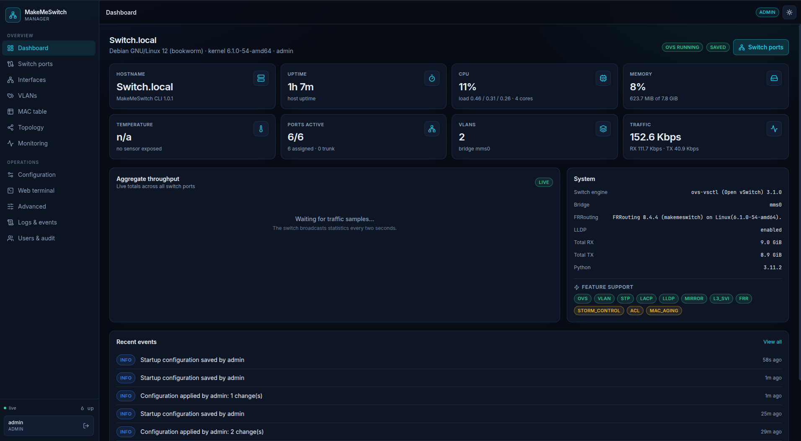
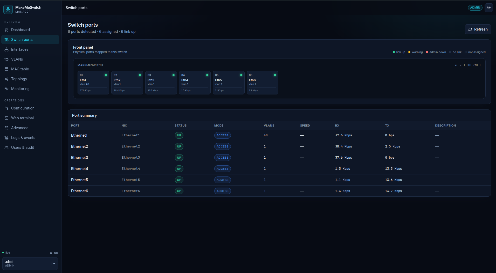
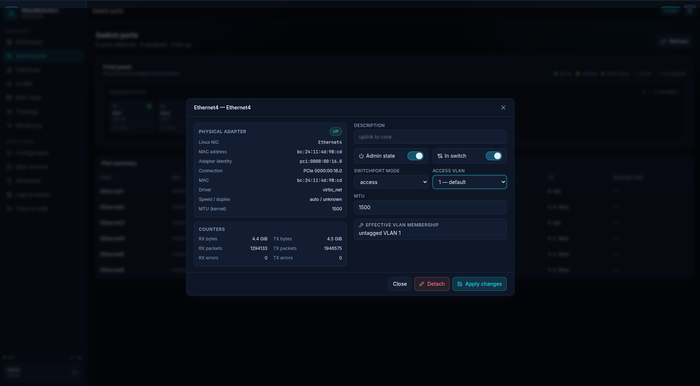

<div align="center">

# MakeMeSwitch

### Turn an ordinary Linux computer into a managed network switch.

**Real Ethernet switching · Familiar network CLI · Web management · Open source**

**Tested: 10.8 Gbit/s virtual switching · ~932 Mbps gigabit internet download**

  

*A practical way to learn switching, build a home lab, or give spare hardware a second life.*

</div>

---

## What is MakeMeSwitch?

**MakeMeSwitch** is a free, open-source application that turns an existing **Debian or Ubuntu** installation into a software-based, managed Ethernet switch.

Take an old mini PC, a small server, a virtual machine, or a Linux-capable single-board computer such as a Raspberry Pi. Add Ethernet interfaces (onboard, PCIe, or USB), install MakeMeSwitch, and manage the resulting switch using a **Cisco IOS-inspired CLI** or a **browser-based dashboard**.

MakeMeSwitch is **not a network simulator**. It uses **Open vSwitch (OVS)** to switch real traffic between real interfaces. VLAN configuration, port state, MAC learning and other supported operations are applied to the Linux host.

It is independent software, not Cisco IOS, and is not affiliated with Cisco.

### Why build it?

- **Learn by doing:** practice VLANs, access and trunk ports, STP, LACP, switch management, and basic routing without buying an enterprise switch.
- **Reuse old hardware:** turn a spare mini PC and extra NICs into a configurable lab switch.
- **Build virtual labs:** connect VMs and virtual NICs and experiment with real packet forwarding.
- **Explore Linux networking:** see how familiar switch commands map to Open vSwitch and the Linux network stack.
- **Automate your lab:** manage configuration through the CLI, web panel, or REST API.

> **Built for hands-on networking labs, education, homelabs and small experimental networks.** MakeMeSwitch uses a real Open vSwitch datapath and can deliver strong performance on suitable hardware. As with any software switch, results depend on the host and interfaces.

## How it works

```text
               SSH CLI              Web browser
                  |                       |
                  v                       v
          +---------------+      +-------------------+
          | Switch-like   |      | Web dashboard     |
          | CLI           |      | + REST API        |
          +---------------+      +-------------------+
                  \                       /
                   \                     /
                    v                   v
                   +---------------------+
                   | MakeMeSwitch engine |
                   | Config / validation |
                   +---------------------+
                              |
                +-------------+-------------+
                |             |             |
                v             v             v
          Open vSwitch   Linux networking   SQLite
          L2 datapath    L3 / interfaces    config
                |
          Ethernet / USB / PCIe NICs
```

MakeMeSwitch provides the management layer. **Open vSwitch does the actual Layer 2 forwarding**, while Linux handles interfaces and basic Layer 3 routing. Configuration and application state are stored locally; CLI and web management use the same underlying engine.

## Screenshots

### Dashboard



### Switch ports



### Live traffic monitoring


### Port configuration



## See it in action

```text
Switch.local# show version
Hostname          Switch.local
MakeMeSwitch CLI  1.0.1
Platform          Debian GNU/Linux 12 (bookworm)
Kernel            6.1.0-54-amd64
Switching engine  ovs-vsctl (Open vSwitch) 3.1.0
Bridge            mms0 (up)
FRRouting         FRRouting 8.4.4 (makemeswitch) on Linux
LLDP              installed
```

Create two VLANs and configure ports using familiar commands:

```text
Switch> enable
Switch# configure terminal
Switch(config)# hostname LAB-SW01
LAB-SW01(config)# vlan 10
LAB-SW01(config-vlan)# name SERVERS
LAB-SW01(config-vlan)# exit
LAB-SW01(config)# vlan 20
LAB-SW01(config-vlan)# name CLIENTS
LAB-SW01(config-vlan)# exit
LAB-SW01(config)# interface ethernet 1
LAB-SW01(config-if)# description Lab server
LAB-SW01(config-if)# switchport mode access
LAB-SW01(config-if)# switchport access vlan 10
LAB-SW01(config-if)# no shutdown
LAB-SW01(config-if)# end
LAB-SW01# show vlan brief
LAB-SW01# show interfaces status
LAB-SW01# show mac address-table
LAB-SW01# write memory
```

The CLI includes context-sensitive `?` help, Tab completion, command abbreviations, interface ranges, command history, and `show` output filters such as `| include` and `| section`.

## Features in v1.0.1

| Area | Capabilities |
| --- | --- |
| **Layer 2 switching** | Access/trunk ports, 802.1Q VLANs, native VLANs, allowed VLAN lists, MAC learning and isolation |
| **Port management** | NIC discovery, stable port mappings, status, counters, descriptions, shutdown/no shutdown, MTU |
| **Switch protocols** | STP/RSTP, LACP/static port channels, port mirroring (SPAN), LLDP via `lldpd` |
| **Basic Layer 3** | IPv4 SVIs, static routes, optional IP forwarding |
| **CLI** | IOS-inspired modes, abbreviations, `?`, Tab, `interface range`, `do`, piped show commands |
| **Web UI** | Dashboard, clickable port panel, VLAN management, MAC table, monitoring, topology, configuration, terminal, users |
| **Configuration** | Running/startup configuration, save, validation, rollback, drift detection |
| **Management** | Dedicated switch SSH CLI, role-based users, REST API, WebSockets, audit logging |
| **Monitoring** | Read-only SNMP v1/v2c, interface counters, bridge/MAC information, remote syslog |
| **Installation** | Debian/Ubuntu installer, systemd services, optional HTTPS |

**Not implemented:** dynamic routing through FRRouting (OSPF/BGP), SNMPv3, QoS, ACLs and storm control. FRRouting may be installed and detected, but its presence does not mean dynamic routing is available.

## Port layout: management and switching

A typical MakeMeSwitch device dedicates its **first physical Ethernet connection to management**, while the remaining NICs become switch ports:

```text
Mini PC / Raspberry Pi / server
  NIC 1  ── Management (Linux IP, SSH, web UI)
  NIC 2  ── Switch port Ethernet1
  NIC 3  ── Switch port Ethernet2
  NIC 4  ── Switch port Ethernet3
  ...
```

The installer protects the **detected management interface** (the NIC carrying host connectivity) and automatically attaches other eligible physical NICs to Open vSwitch. It does **not** select management purely by numerical port position: on a machine with different NIC enumeration, verify which interface holds the management IP and default route before installation. The remaining ports can be assigned VLANs and switched like ports on a managed Ethernet switch.

For manual port assignment, use `sudo ./install.sh --no-attach-all`.

## Performance benchmarks

MakeMeSwitch forwards real traffic through Open vSwitch. The following measurements were recorded on the test setup used during the v1.0.1 release. They are **measured results, not theoretical figures or guaranteed speeds**.

### Virtual switch: over 10 Gbit/s between isolated VMs

Two Debian 12 virtual machines ran on the **same Proxmox host**, each connected to a **different virtual bridge** (`vmbr541` and `vmbr542`). These bridges were connected to **separate virtual NICs on the MakeMeSwitch VM**. Neither test VM was connected directly to the host's `vmbr0` uplink; traffic between the endpoints traversed MakeMeSwitch and its Open vSwitch datapath.

```text
Debian VM A (10.0.0.92)                  Debian VM B (10.0.0.89)
          |                                        |
       vmbr542                                  vmbr541
          |                                        |
          +---- [ MakeMeSwitch VM / OVS ] --------+
                     (separate virtual NICs)
```

**iperf3 TCP results** (30-second measurements, 3-second warm-up excluded):

| Test | Throughput | TCP retransmissions |
| --- | ---: | ---: |
| Single TCP stream, VM A → VM B | **10.8 Gbit/s** | 0 |
| Single TCP stream, VM B → VM A (`-R`) | **10.2 Gbit/s** | 1 |
| Four parallel TCP streams, VM A → VM B (`-P 4`) | **10.3 Gbit/s aggregate** | 0 |

The single-stream forward test transferred **37.7 GiB as reported by iperf3** in 30 seconds. The four-stream test transferred **36.0 GiB** in the same interval. A four-packet ICMP check showed **0% packet loss** and approximately **1.10 ms average round-trip time**.

Reproduce the tests by running `iperf3 -s -p 5202` on one endpoint and these commands on the other:

```bash
iperf3 -c 10.0.0.89 -p 5202 -t 30 -O 3
iperf3 -c 10.0.0.89 -p 5202 -t 30 -O 3 -R
iperf3 -c 10.0.0.89 -p 5202 -t 30 -O 3 -P 4
```

**Scope:** This is a virtualized, same-host benchmark. It demonstrates the throughput achieved in this specific setup, but does not measure physical Ethernet line rate, cross-host networking, or performance on a Raspberry Pi. The physical 1 GbE port-to-port benchmark is planned separately.

### Gigabit internet connectivity

Four Ookla Speedtest runs through the tested network path to **Bahnhof AB, Stockholm (server 75545)** produced:

| Run | Download | Upload | Idle latency |
| --- | ---: | ---: | ---: |
| [1](https://www.speedtest.net/result/c/e17a753b-653c-4ba1-8ddc-ddd68909f415) | 930.48 Mbps | 936.20 Mbps | 4.33 ms |
| [2](https://www.speedtest.net/result/c/8ea5de4f-96bf-445d-804e-3a165ebecd9b) | 933.05 Mbps | 931.81 Mbps | 4.34 ms |
| [3](https://www.speedtest.net/result/c/8c88603c-98b5-429b-9eaa-899043c77f07) | 932.52 Mbps | 934.36 Mbps | 4.43 ms |
| [4](https://www.speedtest.net/result/c/43956674-792a-470e-b787-1fd23a4e81ea) | 932.47 Mbps | 905.62 Mbps | 4.42 ms |
| **Average** | **932.13 Mbps** | **927.00 Mbps** | **4.38 ms** |

These are end-to-end internet speed tests, not controlled physical port-to-port switching benchmarks. Actual performance depends on the CPU, NICs, drivers, virtualization and network topology.

## Hardware and requirements

- **OS:** Debian 12/13 or Ubuntu Server 22.04/24.04+ (the installer targets these releases).
- **Python:** 3.10+ for the package; a suitable Python environment is installed by the installer.
- **Switching:** Open vSwitch, installed automatically.
- **NICs:** onboard Ethernet, PCIe Ethernet adapters, USB Ethernet adapters, or virtual NICs.
- **Architecture:** suitable Linux hardware with supported OS packages and NIC drivers. Raspberry Pi is a possible lab platform, but compatibility and throughput depend on its model, OS image and adapters; it is not guaranteed on every model.

**Example setups:**

- Mini PC + onboard LAN + several USB-to-Ethernet adapters.
- Small x86 server + multi-port PCIe network card.
- Raspberry Pi + USB Ethernet adapters for a compact learning lab.
- Debian/Ubuntu VM with multiple virtual NICs for isolated experiments.

USB adapters share host resources and may have lower or less predictable performance than PCIe NICs. This is software switching powered by Open vSwitch rather than a dedicated switch ASIC; on suitable hardware, gigabit-class throughput is achievable, as illustrated by the test results above.

## Installation

Download the **v1.0.1 source archive** from this repository's **Releases** page, extract it, and run the installer from the project directory:

```bash
cd makemeswitch
sudo ./install.sh
```

Alternatively, clone this repository and run the same command from the cloned directory.

The installer installs the required Linux packages, creates a Python virtual environment, installs the application and web assets, configures systemd services, and initializes the switch.

### Important: read before installing remotely

**By default, the installer changes SSH access:**

| Port | Purpose |
| --- | --- |
| **22/tcp** | MakeMeSwitch CLI (switch accounts) |
| **8022/tcp** | Normal Debian/Ubuntu SSH shell (OS accounts) |
| **8000/tcp** | Web dashboard and API (HTTP by default) |
| **161/udp** | Read-only SNMP agent (default community `public`) |

**Open port 8022 in your firewall and verify you have console/recovery access before installation.** To keep normal SSH on port 22, use:

```bash
sudo ./install.sh --keep-ssh-22
```

**By default, the installer also attaches detected physical NICs other than the management interface to OVS.** To choose ports manually instead, use:

```bash
sudo ./install.sh --keep-ssh-22 --no-attach-all
```

This is the recommended first installation on a remote machine. Although the installer attempts to protect the management NIC, changing networking remotely always carries a risk of disconnection.

### Installer options

```bash
sudo ./install.sh --help
```

Useful options include `--no-web`, `--bind`, `--port`, `--https`, `--tls-cert`, `--tls-key`, `--admin-user`, `--admin-password`, `--no-attach-all` and `--keep-ssh-22`.

## First login

After a default installation, replace `<switch-ip>` with your host's management IP:

| Access | Command / URL |
| --- | --- |
| Local switch CLI | `sudo makemeswitch` |
| Switch CLI via SSH | `ssh admin@<switch-ip>` |
| Host shell via SSH | `ssh <linux-user>@<switch-ip> -p 8022` |
| Web dashboard | `http://<switch-ip>:8000/` |

The initial web/switch administrator is **`admin`**, with default password **`MakeMeSwitch`** unless changed during installation. The installer also stores initial credentials in `/root/makemeswitch-initial-credentials.txt`.

**Change the default password immediately:**

```bash
sudo makemeswitch user passwd admin
```

Do not expose the default HTTP panel, SNMP community, or switch SSH service directly to the public internet. Use a trusted management network, firewall restrictions, and HTTPS for remote management.

## A few useful commands

```text
show version
show interfaces status
show interfaces mapping
show interfaces counters
show vlan brief
show mac address-table
show spanning-tree
show port-channel summary
show lldp neighbors
show ip interface brief
show running-config
show startup-config
show configuration drift
show logging
write memory
```

Use `?` inside the CLI to explore commands and options. For example, `show ?`, `interface ?` or `switchport ?`.

### Save your configuration

MakeMeSwitch distinguishes **running-config** from **startup-config**. Changes take effect in the running configuration, while `write memory` saves them for restoration after restart.

```text
Switch# show running-config
Switch# write memory
Switch# show startup-config
```

## Web management

The browser interface offers a visual way to work with the same switch configuration:

- **Dashboard:** system information, port status, uptime and traffic.
- **Ports & interfaces:** clickable port layout, VLAN assignment, link state and counters.
- **VLANs:** create VLANs, assign access/trunk ports and inspect membership.
- **MAC & topology:** learned addresses and LLDP neighbor information where available.
- **Monitoring:** live statistics and switch events.
- **Configuration:** view, save, compare and roll back configuration.
- **Terminal:** interact with the switch CLI from the browser.
- **Advanced:** supported L2/L3 settings, users and monitoring configuration.

CLI and web changes share the same configuration engine. The web interface is not a separate simulator.

## Monitoring and automation

MakeMeSwitch includes a REST API with an OpenAPI interface at `http://<switch-ip>:8000/docs` (authentication required for protected operations). It also provides live statistics over WebSockets.

The read-only SNMP agent supports SNMP v1/v2c and common system, interface and bridge information, including learned MAC addresses. Remote syslog is available for forwarding switch events to a collector. **SNMPv3 is not available in v1.0.1.**

## Troubleshooting

Check the services and Open vSwitch state:

```bash
sudo systemctl status makemeswitch
sudo systemctl status makemeswitch-ssh
sudo systemctl status makemeswitch-snmpd
sudo systemctl status openvswitch-switch
sudo journalctl -u makemeswitch -n 100 --no-pager
sudo ovs-vsctl show
sudo makemeswitch doctor
```

For a newly attached NIC, check `show interfaces mapping` and the host's `ip -br link` output. New adapter discovery/naming may require a reboot. If the web panel cannot be reached, verify the bind address, port and firewall rules.

## Limitations and safety

- **Software datapath:** measured gigabit-class performance is possible, but throughput and latency depend on CPU, NIC drivers, USB topology and host load. Internet speed tests do not establish maximum port-to-port forwarding capacity.
- **Remote access changes:** default installation moves host SSH to port 8022 and assigns non-management NICs. Review options before running it on a live server.
- **Management exposure:** the web panel defaults to HTTP on `0.0.0.0:8000`; SNMP v1/v2c is not encrypted. Restrict access to a trusted management network.
- **Routing:** IPv4 static routing is supported; dynamic routing protocols are not implemented.
- **Hardware variability:** USB adapters, hotplug behavior and link reporting differ between devices; adding adapters may require a reboot.
- **Feature scope:** no SNMPv3, ACL, QoS or storm-control implementation in this release.

MakeMeSwitch is intended to help you experiment with networking, not to conceal the underlying Linux host or guarantee production-grade availability.

## Uninstall

From the project directory:

```bash
sudo ./uninstall.sh
```

See `./uninstall.sh --help` before using purge options. Back up your switch configuration and verify network connectivity before removing a switch with active ports.

## Contributing

Bug reports, feature requests, documentation improvements and pull requests are welcome. If reporting an issue, include the OS version, MakeMeSwitch version, Open vSwitch version, relevant logs and steps to reproduce. **Remove passwords, tokens, public IPs and other secrets from logs before sharing.**

## License and attribution

Licensed under the **Apache License 2.0** — see [LICENSE](LICENSE).

MakeMeSwitch is an independent open-source project. Its command-line syntax is inspired by familiar enterprise networking conventions; it does not contain Cisco IOS code and is not endorsed by or affiliated with Cisco Systems. Cisco and Cisco IOS are trademarks of Cisco Systems, Inc.

---

<div align="center">

**MakeMeSwitch v1.0.1 — one computer, multiple ports, a real networking lab.**

</div>
